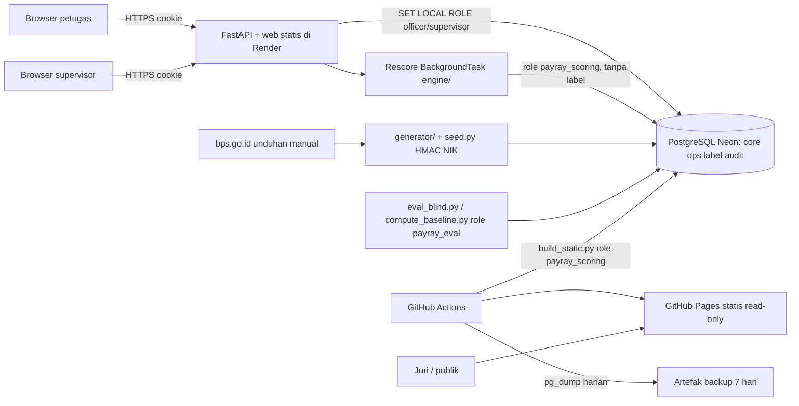

<!-- planything project:0b2cebdd-f5d3-4cc4-adfb-559a815ba259 | managed file: keep task ids, only edit the [ ] markers and Note lines -->

# PayRay v2: Antrean Risiko Kepatuhan Iuran JKN Berbasis API untuk Petugas Pemeriksa

## 1. Ringkasan

PayRay mengurutkan badan usaha (BU) PPU berdasarkan kemungkinan ketidakpatuhan iuran JKN: upah dilaporkan lebih rendah, pendaftaran pekerja sebagian, dan pergeseran PPU ke PBPU. Tujuannya supaya petugas pemeriksa memeriksa BU paling berisiko lebih dulu. Prinsip produknya: **PayRay mengurutkan, bukan menuduh.**

Kondisi repo saat ini (`github.com/rachdiaan/healthkathon-bpjs`):
- Generator data sintetis berisi 5.000 BU.
- `engine/` berisi rules, Isolation Forest, skor, confidence, reason codes, dan estimasi Rp.
- `ml/` berisi model terkalibrasi (P@10% 82,2%) yang jalan di browser.
- Dashboard berupa satu HTML statis 3,6 MB dengan data tertanam. Feedback hanya bisa diekspor ke CSV.
- `db/schema.sql` ada tapi belum dipakai.
- Deck 20 slide.

Upgrade ini mencakup:
1. Backend FastAPI + PostgreSQL di atas `db/schema.sql`, dengan 2 peran, audit log, NIK terpseudonim, dan isolasi schema label di level database.
2. UI ulang yang mengikuti alur kerja petugas: antrean > scan sheet > inspeksi > feedback.
3. Frontend plain HTML/CSS/JS yang di-serve API, plus build statis read-only di GitHub Pages sebagai fallback.
4. Perbaikan model untuk estimasi Rp, recall pemotongan upah parsial dan pendaftaran parsial, serta false flag pada BU padat karya.
5. Validasi blind dengan seed rahasia, dijalankan oleh non-modeler.
6. Data BPS resmi, verifikasi regulasi, QA/security, video demo, dan deck dengan screenshot asli.

Semua data 100% sintetis + publik. Kalau dokumen konsep lama (.txt) bertentangan dengan repo, repo yang menang.

## 2. Business Case & Go/No-Go

| Cost item | Estimate | Basis |
|---|---|---|
| Lead Engineer (backend, scoring, deploy, CI) | 18 person-days | Estimasi tim berdasarkan task T1–T6, T10, T11, T13, T16, T17, T22 di §22 [verify] |
| Data Scientist (data BPS, model, eval) | 10 person-days | Task T14, T18, T19, T21 [verify] |
| PM/UI designer (UX, frontend UI, blind injection, deck, video) | 12 person-days | Task T7–T9, T12, T15, T20, T23, T24 [verify] |
| Hosting API (Render free web service) | Rp 0/bulan | Free tier, ada cold start [verify limit] |
| Database (Neon free Postgres) | Rp 0/bulan | Free tier [verify kuota storage & compute] |
| GitHub Pages + GitHub Actions | Rp 0/bulan | Repo publik [verify kuota menit Actions] |
| AI/LLM API | Rp 0/bulan | Tidak ada LLM di produk (lihat §15) |
| Langganan coding agent | Rp 0 marginal | Diasumsikan sudah dimiliki tim [verify] |
| **Total 12 bulan** | **Rp 30.000.000** | Effort sekali + running Rp 0 |


- **Skenario A: hackathon saja, tanpa pilot.**
  - Benefit moneter Rp 0.
  - ROI 12 bulan = (0 − 30 jt) / 30 jt = **−100%**. Tidak ada payback.
  - Outcome non-moneter yang diukur:
    - Lift hit rate vs baseline acak di blind set (§5, M-3).
    - Petugas uji bisa membuka antrean 10 BU teratas tanpa bantuan (§5, M-1).


Biaya kas Rp 0. Biaya riil hanya waktu tim yang memang dialokasikan untuk hackathon. Keputusan GO didasarkan pada outcome non-moneter yang terukur, bukan ROI moneter.

- [KILL-1] Kurang dari 2 dari 3 penguji (tanpa bantuan) berhasil membuka antrean 10 BU teratas dan scan sheet BU peringkat 1 dalam ≤ 2 menit → UI dirombak dulu sebelum Fase 2 (checked at akhir Fase 1)
- [KILL-2] Isolasi schema `label` (role `payray_officer`/`payray_scoring` mendapat `permission denied`) tidak bisa diterapkan di DB hosting → pindah penyedia Postgres sebelum lanjut (checked at akhir Fase 1)
- [KILL-3] Lebih dari 2 dari 5 percobaan warm-up API live gagal merespons `/health` dalam 60 detik → demo utama dipindah ke Pages statis, live hanya ditampilkan sebagai rekaman video (checked at akhir Fase 2)
- [KILL-4] Lift P@10% pada blind set < 2× baseline prevalensi → klaim akurasi dihapus dari deck, PayRay dipresentasikan sebagai triage berbasis rules + anomali (checked at akhir Fase 3)
- [KILL-5] Spearman estimasi Rp vs kerugian sebenarnya pada blind set < 0,40 → angka Rp tunggal dihapus dari UI dan deck, diganti band rendah/sedang/tinggi saja (checked at akhir Fase 3)
- [KILL-6] Fase 2 belum lolos exit criteria H-7 sebelum demo day [verify tanggal] → layar supervisor dipotong ke metrik saja, scope dibekukan (checked at H-7)

**Go/No-Go:** GO WITH CONDITIONS: biaya running tetap Rp 0 (free tier saja), scope dibekukan di Fase 1–4 dokumen ini, dan setiap [KILL-n] dicek tepat di fasenya dengan hasil yang dicatat di README.

## 3. Masalah & Peluang

**Masalah.** Petugas pemeriksa kepatuhan memegang ratusan BU PPU, sementara kapasitas pemeriksaannya terbatas. Saat ini target dipilih dari laporan tunggakan, keluhan pekerja, atau Excel rekap upah, lalu dicocokkan manual dengan UMK dan data sektor. Cara ini punya dua celah:
- BU yang membayar tepat waktu tapi melaporkan upah lebih rendah atau hanya mendaftarkan sebagian pekerja tidak muncul di laporan tunggakan.
- Alasan memilih satu BU sulit dipertanggungjawabkan secara konsisten.

**Masalah di versi sekarang:**
- Dashboard berupa HTML statis 3,6 MB dengan data tertanam. Tidak ada login, audit, atau penyimpanan hasil inspeksi; feedback hanya berupa CSV lokal.
- Model masih lemah di beberapa titik:
  - Estimasi Rp berkorelasi 0,30–0,36 dengan kerugian sebenarnya.
  - Recall pemotongan upah parsial sekitar 20%, pendaftaran parsial sekitar 35%.
  - 6–7% BU padat karya yang patuh ikut ter-flag.
- Data upah masih memakai sumber BPS sekunder.
- Batas upah dan PP 36/2021 belum diverifikasi.

**Peluang.**
- Antrean berperingkat, dengan alasan yang bisa dibaca dan confidence yang jujur, memberi petugas dasar pemilihan yang bisa dipertanggungjawabkan. Ini adalah alasan pindah dari cara lama (jawaban klarifikasi).
- Hasil inspeksi yang tersimpan memungkinkan supervisor mengukur hit rate tim dibanding pemilihan acak.
- Belum ada data publik soal berapa jam yang dihabiskan petugas untuk memilih target [verify].

## 4. Target Pengguna & Persona

**Persona utama: Petugas Pemeriksa Kepatuhan, Kantor Cabang BPJS Kesehatan.**
- Memegang ratusan BU PPU.
- Hari ini memilih target dari laporan tunggakan, keluhan pekerja, atau Excel rekap upah, lalu mencocokkan manual dengan UMK dan data sektor.
- Butuh: BU mana yang paling layak diperiksa minggu ini, plus alasannya.
- Wajib bisa di sesi pertama tanpa bantuan: **membuka antrean 10 BU teratas.**
- Alasan kembali besok pagi:
  - Antrean sudah diperbarui setelah batch rescore berkala.
  - Status hasil inspeksi yang dia input sebelumnya terlihat.
- Catatan: persona ini asumsi tim dan belum divalidasi lewat wawancara petugas [verify].

**Persona sekunder: Supervisor (atasan petugas di Kantor Cabang).**
- Memicu dan memublikasikan batch rescore per periode.
- Melihat hit rate tim dibanding pemilihan acak.
- Membaca audit log.

**Audiens demo (bukan pengguna sistem):** juri Healthkathon 2026. Mereka mengakses Pages statis atau versi live dengan akun demo.

## 5. Tujuan & Metrik Sukses

| ID | Metrik | Target | Cara ukur |
|---|---|---|---|
| M-1 | Penguji membuka antrean 10 teratas tanpa bantuan | ≥ 2 dari 3 penguji, ≤ 2 menit dari halaman login | Tes hallway, dicatat di `docs/usability.md` |
| M-2 | Waktu muat antrean (API warm) | p95 ≤ 300 ms untuk 5.000 BU | Log latency API |
| M-3 | Lift P@10% pada blind set | ≥ 2× baseline prevalensi (lihat KILL-4) | `scripts/eval_blind.py`, jalan sekali |
| M-4 | Spearman Rp estimasi vs kerugian sebenarnya | ≥ 0,50 di validation; ≥ 0,40 di blind (KILL-5) | Definisi metrik di [BR-19] |
| M-5 | Recall pemotongan upah parsial di top 10% | dari ~20% ke ≥ 35% (target, bukan klaim) | [BR-19] |
| M-6 | Recall pendaftaran parsial di top 10% | dari ~35% ke ≥ 50% (target) | [BR-19] |
| M-7 | False flag BU padat karya patuh di top 10% | dari 6–7% ke ≤ 3% (target) | [BR-19] |
| M-8 | Kebocoran label ke peran officer/scoring | 0 query sukses | Tes permission DB [SEC-2] |
| M-9 | Kebocoran NIK mentah | 0 match regex `\b\d{16}\b` di DB dan snapshot statis | Tes [SEC-7] |
| M-10 | Fallback statis siap demo | Pages memuat antrean ≤ 3 detik di koneksi 4G [verify cara ukur] | Lighthouse/DevTools throttling |

Target M-4 sampai M-7 adalah tujuan. Kalau tidak tercapai, hasilnya dilaporkan apa adanya dan tidak boleh di-retune di holdout/blind.

## 6. Di Luar Cakupan

Jangan dibangun:
- Integrasi data BPJS asli atau sistem internal BPJS. Semua data sintetis + publik.
- SSO/LDAP/OAuth. Login username + password lokal saja.
- UI manajemen user dan self-registration. User dibuat lewat seed script.
- Penjelasan berbasis LLM, chatbot, atau penggunaan Laya/Jev.
- Scoring real-time. Rescore hanya batch per periode.
- Retraining otomatis dari hasil inspeksi. Label inspeksi hanya untuk metrik.
- Workflow penugasan/penjadwalan inspeksi antar petugas.
- Upload file bukti inspeksi.
- Notifikasi email/WA/push.
- Perhitungan tagihan, denda, atau sanksi. Estimasi Rp hanya indikatif.
- Multi-tenant/multi-cabang dengan UI admin. Cukup seed 1–2 cabang sintetis.
- Aplikasi mobile native, PWA offline sync, bahasa Inggris/i18n.
- Framework frontend (React/Vue/Svelte), library chart, component library.
- Hash-chain atau signature untuk audit log (lihat [DEBT-4]).

## 7. User Stories

- As a petugas pemeriksa, I want membuka antrean 10 BU paling berisiko di cabang saya begitu login, so that saya tahu siapa yang diperiksa minggu ini tanpa menyusun Excel manual.
- As a petugas pemeriksa, I want melihat reason codes, confidence, dan rentang Rp per BU, so that saya punya alasan yang bisa dipertanggungjawabkan saat memilih target.
- As a petugas pemeriksa, I want melihat badge perlindungan UMKM padat karya, so that saya tidak memperlakukan usaha kecil padat karya yang patuh seperti pelanggar.
- As a petugas pemeriksa, I want mencatat hasil inspeksi lewat form, so that hasilnya tersimpan dan tidak hilang di CSV lokal.
- As a petugas pemeriksa, I want melihat status inspeksi yang saya input kemarin, so that saya tahu pekerjaan mana yang sudah tercatat.
- As a petugas pemeriksa, I want mengoreksi inspeksi saya sendiri dalam 7 hari, so that salah input bisa diperbaiki tanpa menghapus jejak.
- As a supervisor, I want memicu dan memublikasikan batch rescore per periode, so that antrean tim selalu memakai data periode terbaru.
- As a supervisor, I want melihat hit rate tim dibanding baseline acak, so that saya bisa menilai apakah PayRay lebih baik daripada memilih asal.
- As a supervisor, I want membaca audit log cabang saya, so that setiap akses dan perubahan bisa ditelusuri.
- As a juri demo, I want membuka versi statis di GitHub Pages saat API sedang cold start, so that demo tetap jalan.

## 8. Fitur & Kebutuhan Fungsional

### Fondasi: Auth, Peran, Audit Log, Pseudonimisasi NIK
**Fase:** 1 · **Prioritas:** Must

Login lokal, 2 peran, session cookie, isolasi schema DB per peran, audit log append-only, dan NIK yang disimpan hanya sebagai token HMAC.

- [FR-1] The system shall mengautentikasi user lewat `POST /api/auth/login` dengan password ter-hash `hashlib.scrypt`, lalu menerbitkan session token acak (`secrets.token_urlsafe(32)`). Token disimpan di DB sebagai hash SHA-256, dikirim sebagai cookie `HttpOnly; Secure; SameSite=Strict`, dan kedaluwarsa absolut 8 jam.
- [FR-2] The system shall menjalankan setiap request ber-auth di dalam transaksi dengan `SET LOCAL ROLE` sesuai peran: `payray_officer` atau `payray_supervisor`. Role `payray_officer` dan `payray_scoring` tidak punya hak SELECT pada schema `label`.
- [FR-3] The system shall menulis satu baris `audit.event` dalam transaksi yang sama untuk setiap login (berhasil/gagal), logout, baca scan sheet, submit/koreksi/batal inspeksi, rescore, publish batch, ekspor CSV, dan baca audit log.
- [FR-4] The system shall menyimpan NIK hanya sebagai `HMAC-SHA256(PAYRAY_NIK_KEY, nik)` dalam hex. Generator/seeder mengubah NIK sebelum insert dan tidak pernah menulis NIK mentah ke DB, file, atau log.
- [FR-5] The system shall menolak login ke-6 untuk username yang sama dalam 15 menit setelah 5 kegagalan, dengan HTTP 429 dan pesan generik.

### Antrean Risiko (Triage Queue)
**Fase:** 1 · **Prioritas:** Must

Layar utama petugas: BU di cabangnya, diurutkan berdasarkan skor dari batch terpublikasi terbaru.

- [FR-6] The system shall mengembalikan `GET /api/queue` berisi BU dari batch `published` terbaru untuk cabang user. Urutan `score DESC, employer_id ASC`, default 10 item, maksimal 100 per halaman.
- [FR-7] The system shall menyertakan per item: rank, nama BU, sektor, skor, confidence bucket, maksimal 3 reason code teratas, rentang Rp (`rp_low`, `rp_high`), flag `sme_protection`, dan `inspection_status` periode berjalan (`none` | `submitted`).
- [FR-8] The system shall memakai cursor pagination yang mengunci `batch_id`, sehingga publish batch baru di tengah scroll tidak mengacak halaman berikutnya.
- [FR-9] The system shall menampilkan antrean 10 BU teratas langsung setelah login petugas, tanpa klik tambahan.
- [FR-10] The system shall menyediakan `GET /api/queue.csv` (maksimal 500 baris, scope cabang, tanpa `nik_token` dan tanpa data label). File dibuat on-the-fly, tidak disimpan, dan sel diawali `= + - @` diberi prefix `'`.

### Scan Sheet BU
**Fase:** 1 · **Prioritas:** Must

Detail satu BU: alasan, bukti angka, confidence, Rp, perlindungan UMKM, dan checklist pemeriksaan.

- [FR-11] The system shall mengembalikan `GET /api/employers/{id}/scan-sheet` hanya untuk BU di cabang user. BU di luar cabang menghasilkan 404, bukan 403.
- [FR-12] The system shall menampilkan semua reason code BU, diurutkan berdasarkan kontribusi. Tiap reason code punya kalimat yang bisa dibaca manusia, nilai bukti (mis. median upah vs UMK kab/kota), dan item checklist pemeriksaan yang terkait.
- [FR-13] The system shall menampilkan estimasi Rp sebagai rentang `rp_low`–`rp_high` berlabel "indikatif, bukan tagihan". Kalau KILL-5 terpicu, yang tampil hanya band `rendah | sedang | tinggi`.
- [FR-14] The system shall menampilkan badge "Perlindungan UMKM padat karya" beserta penjelasannya bila `sme_protection = true`. Bila confidence `rendah`, tampilkan juga chip "Verifikasi data dulu".
- [FR-15] The system shall menampilkan daftar pekerja ter-flag hanya dengan 8 karakter pertama `nik_token`, tidak pernah NIK.

### Form Hasil Inspeksi & Riwayat Saya
**Fase:** 2 · **Prioritas:** Must

Petugas mencatat hasil inspeksi ke API. Hasil ini menjadi label baru. Petugas melihat status input miliknya sendiri.

- [FR-16] The system shall menerima `POST /api/inspections` dengan header `Idempotency-Key` (UUID) dan body `{employer_id, inspected_on, outcome, violation_types[], rp_found?, notes?}`. Field lain ditolak 422. `officer_id` dan `branch_id` diambil dari session.
- [FR-17] The system shall menyimpan metadata inspeksi ke `ops.inspection` dan hasilnya ke `label.inspection_outcome` dalam satu transaksi. Officer melakukan INSERT ke `label` tanpa `RETURNING`.
- [FR-18] The system shall mengembalikan `GET /api/inspections/mine` berisi daftar inspeksi milik user, dengan field dari `ops.inspection` saja (status, tanggal, BU, rank saat dipilih), tanpa outcome.
- [FR-19] The system shall mengizinkan koreksi lewat `POST /api/inspections/{id}/supersede` oleh petugas pemilik dalam 7 hari sejak submit. Koreksi membuat record baru dengan `supersedes_id`.
- [FR-20] The system shall mengizinkan supervisor membatalkan inspeksi di cabangnya lewat `POST /api/inspections/{id}/cancel` dengan `reason` wajib (10–500 karakter).

### Batch Rescore & Publikasi Periode
**Fase:** 2 · **Prioritas:** Must

Supervisor memicu scoring ulang per periode. Hasilnya baru dipakai antrean setelah dipublikasikan.

- [FR-21] The system shall menerima `POST /api/rescore-batches` `{period: "YYYY-MM"}` dari supervisor, membuat batch `running`, lalu menjalankan `engine/` sebagai FastAPI BackgroundTask dengan koneksi role `payray_scoring`.
- [FR-22] The system shall menolak batch kedua dengan 409 selama masih ada batch `running` (unique partial index), dan menolak dengan 429 bila batch terakhir dibuat kurang dari 5 menit lalu.
- [FR-23] The system shall menandai batch `ready` bila semua skor tertulis, atau `failed` dengan pesan error bila gagal. Tidak ada retry otomatis.
- [FR-24] The system shall mempublikasikan batch `ready` lewat `POST /api/rescore-batches/{id}/publish` secara atomik: batch `published` sebelumnya untuk cabang yang sama menjadi `archived` dalam transaksi yang sama.
- [FR-25] The system shall mencatat `model_version` (hash artefak model) dan `engine_version` (git SHA) di setiap batch.

### Metrik Supervisor
**Fase:** 2 · **Prioritas:** Should

- [FR-26] The system shall mengembalikan `GET /api/metrics?period=YYYY-MM` untuk cabang supervisor, berisi: hit rate, baseline, lift, coverage top-10, jumlah inspeksi per outcome, dan `n` ([BR-16]–[BR-18]).
- [FR-27] The system shall menampilkan "Data belum cukup (n < 10)" alih-alih angka hit rate/lift bila penyebut < 10.
- [FR-28] The system shall memberi label baseline "Baseline acak (prevalensi sintetis)" dan menampilkan `computed_at` dari `ops.metric_snapshot`.
- [FR-29] The system shall mengembalikan `GET /api/audit-events` (supervisor, scope cabang, maksimal 100 per halaman, filter `action`, `actor_id`, `from`, `to`).

### Fallback Statis GitHub Pages
**Fase:** 2 · **Prioritas:** Must

Frontend yang sama, di-build dengan mode statis dan membaca snapshot JSON. Read-only.

- [FR-30] The system shall menghasilkan `web-static/data/snapshot.json` lewat `scripts/build_static.py`, memakai koneksi role `payray_scoring` dan allowlist field: tanpa label, tanpa ground truth, `nik_token` dipotong 8 karakter.
- [FR-31] The system shall menampilkan banner permanen "Mode statis: data batch <period>, dibuat <generated_at WIB>. Form inspeksi tersimpan lokal, bukan ke server." beserta link ke versi live.
- [FR-32] The system shall menonaktifkan pengiriman inspeksi ke server di mode statis. Feedback tetap bisa diekspor ke CSV lokal, mempertahankan fungsi lama.
- [FR-33] The system shall men-deploy Pages lewat GitHub Actions setiap batch dipublikasikan (workflow_dispatch) dan setiap push ke `main`.

### Peningkatan Model, Data Publik & Validasi Blind
**Fase:** 3 · **Prioritas:** Must

- [FR-34] The system shall memakai tabel upah dari bps.go.id (URL tabel dan tanggal akses dicatat di `data/SOURCES.md`) sebagai pengganti data BPS sekunder. Parameter regulasi (batas upah, persentase iuran, rujukan PP 36/2021) disimpan di `engine/params.py`, masing-masing dengan sumber [verify].
- [FR-35] The system shall menghitung estimasi Rp sebagai rentang (`rp_low`, `rp_point`, `rp_high`) dalam integer rupiah. Metode diperbaiki DS hanya dengan data train/validation.
- [FR-36] The system shall menambah fitur yang relatif terhadap sektor dan wilayah (upah vs median sektor-kab/kota, rasio pekerja terdaftar vs tenaga kerja sektor), untuk menaikkan recall pemotongan upah parsial dan pendaftaran parsial serta menurunkan false flag padat karya.
- [FR-37] The system shall membekukan model sebelum blind eval: SHA-256 artefak model di-commit di `ml/FROZEN.txt` sebelum seed rahasia dipakai.
- [FR-38] The system shall menjalankan `scripts/eval_blind.py` tepat sekali pada blind set. Hasil ditulis ke `docs/eval-blind.md` apa adanya, termasuk bila lebih buruk dari holdout.

## 9. Aturan Bisnis & Edge Case

**Bahasa dan pengurutan**
- [BR-1] UI, ekspor, dan deck tidak memakai kata "pelanggar", "curang", atau "fraud" untuk BU di antrean. Istilah yang dipakai: "prioritas pemeriksaan" dan "indikasi". Rule ini dicek lewat grep di CI pada `web/`.
- [BR-2] Antrean berasal hanya dari batch `published` terbaru per cabang. Urutan `score DESC, employer_id ASC`. Rank dihitung sekali saat batch ditulis, tidak dihitung ulang saat query.
- [BR-3] Confidence bucket memakai interval setengah terbuka: `tinggi` = c ≥ 0,70; `sedang` = 0,40 ≤ c < 0,70; `rendah` = c < 0,40. Kalau `engine/` sudah punya ambang lain, angka di repo yang dipakai (default, confirm).

**Perlindungan UMKM dan Rp**
- [BR-4] `sme_protection = is_sme AND is_labor_intensive`.
  - Definisi UMKM dan sektor padat karya ditulis di `data/SOURCES.md` [verify kriteria UMKM PP 7/2021 dan daftar KBLI padat karya].
  - Badge tidak mengubah rank.
  - Badge + confidence `rendah` menampilkan chip "Verifikasi data dulu".
  - Scan sheet menampilkan catatan "pendekatan pembinaan lebih dulu".
- [BR-5] Estimasi Rp disimpan sebagai integer rupiah (`bigint`) dan dihitung dengan `Decimal`. Tampilan dibulatkan half-up ke Rp 100.000 terdekat, dengan label "indikatif". Rp tidak pernah dipakai sebagai tagihan dan tidak dijumlahkan menjadi "total kerugian" di UI.
- [BR-6] Parameter iuran PPU: 5% (4% pemberi kerja, 1% pekerja), batas atas upah Rp 12.000.000 [verify Perpres 64/2020 dan perubahan setelahnya], dan acuan upah minimum PP 36/2021 [verify amandemen PP 51/2023]. Nilai hanya ada di `engine/params.py`.

**Inspeksi**
- [BR-7] Hanya peran officer yang bisa submit inspeksi, dan hanya untuk BU di cabangnya yang ada di batch `published` saat ini (rank berapa pun). Supervisor tidak bisa submit.
- [BR-8] `inspected_on`:
  - Tidak boleh di masa depan (dibanding tanggal hari ini WIB).
  - Tidak boleh lebih dari 30 hari ke belakang.
  - Tidak boleh sebelum tanggal `published_at` batch aktif (WIB).
  - Pelanggaran → 422 (default, confirm).
- [BR-9] Periode inspeksi = `to_char(inspected_on, 'YYYY-MM')`. `inspected_on` adalah `date` dalam zona Asia/Jakarta. Semua timestamp disimpan `timestamptz` (UTC) dan ditampilkan dalam WIB.
- [BR-10] Maksimal satu inspeksi berstatus `submitted` per (employer_id, periode) per cabang. Submit kedua → 409 "BU ini sudah diperiksa periode ini", tanpa membuka outcome.
- [BR-11] Koreksi:
  - Petugas boleh supersede inspeksi **miliknya sendiri** dalam 7×24 jam sejak `created_at`. Lewat dari itu → 403.
  - Petugas tidak boleh supersede atau cancel milik petugas lain.
  - Record lama menjadi `superseded` (default, confirm).
- [BR-12] Supervisor boleh `cancel` inspeksi di cabangnya dengan alasan wajib, tapi tidak boleh mengubah outcome. Supervisor boleh mempublikasikan batch yang dia picu sendiri, karena demo hanya punya 1 supervisor per cabang (default, confirm).

**Visibilitas status inspeksi**
- [BR-13] Aturan per status:
  - `submitted`: tampil di Riwayat Saya, memberi flag "Sudah diperiksa" di antrean, dihitung di metrik.
  - `superseded`: tersembunyi di Riwayat Saya kecuali toggle "Tampilkan koreksi", tidak dihitung di metrik, tidak memberi flag antrean.
  - `cancelled`: tampil di Riwayat Saya dengan label "Dibatalkan supervisor" + alasan, tidak dihitung di metrik, tidak memberi flag antrean.
  - Ekspor CSV antrean hanya membawa flag dari `submitted`.

**Batch rescore**
- [BR-14] Aturan per status batch:
  - `running` dan `ready`: hanya terlihat di daftar batch supervisor.
  - `published`: sumber antrean. Tepat satu per cabang.
  - `failed`: terlihat di daftar supervisor beserta error.
  - `archived`: tidak dipakai antrean, tetap terlihat di daftar supervisor. Skornya disimpan dan cursor lama masih bisa dibaca.
- [BR-15] Batas rescore:
  - Maksimal 1 batch `running` secara global.
  - Jeda minimal 5 menit antar batch.
  - Maksimal 50.000 BU per batch.
  - Periode `YYYY-MM` tidak boleh lebih dari bulan berjalan (WIB).
  - Gagal → `failed`. Retry dilakukan manual oleh supervisor dengan membuat batch baru.

**Metrik**
- [BR-16] Hit rate (periode P, cabang B):
  - Pembilang = jumlah inspeksi `submitted` dengan outcome `violation_found`.
  - Penyebut = jumlah inspeksi `submitted` dengan outcome ∈ {`violation_found`, `no_violation`}.
  - `inconclusive` dikeluarkan dari keduanya dan ditampilkan terpisah.
  - Bila penyebut < 10, tampilkan "Data belum cukup".
- [BR-17] Baseline = jumlah BU aktif di B dengan `label.ground_truth.is_noncompliant = true` pada P, dibagi jumlah BU aktif di B pada P. Dihitung oleh job eval (role `payray_eval`) dan disimpan di `ops.metric_snapshot`. Lift = hit rate / baseline. Bila baseline = 0, lift ditampilkan "n/a".
- [BR-18] Coverage top-10 = jumlah BU berbeda dengan rank 1–10 di batch `published` yang punya inspeksi `submitted` di P, dibagi 10.
- [BR-19] Metrik model (offline, tidak di UI petugas). N = jumlah BU di set eval, K = ceil(0,10 × N):
  - P@10% = jumlah BU noncompliant di top K / K.
  - Recall tipe t = jumlah kasus tipe t di top K / jumlah seluruh kasus tipe t.
  - False flag padat karya = jumlah BU padat karya patuh di top K / jumlah seluruh BU padat karya patuh [verify definisi ini sama dengan angka 6–7% saat ini].
  - Korelasi Rp = Spearman antara `rp_point` dan `true_loss_rp` pada BU noncompliant [verify apakah angka 0,30–0,36 sebelumnya Pearson atau Spearman; laporkan keduanya].
- [BR-20] Split train/validation/holdout dibekukan di `ml/splits.json`.
  - Tidak boleh ada perubahan fitur, hyperparameter, atau threshold setelah melihat metrik holdout atau blind.
  - Blind set dibuat oleh PM (non-modeler) dengan seed rahasia yang tidak masuk repo, dan dievaluasi sekali setelah [FR-37].

**Data pribadi, ekspor, session, batas**
- [BR-21] NIK mentah tidak pernah disimpan. Tampilan hanya 8 karakter hex pertama token. `PAYRAY_NIK_KEY` minimal 32 byte, disimpan di env secret.
- [BR-22] Ekspor CSV antrean:
  - Officer dan supervisor, scope cabang, maksimal 500 baris.
  - Kolom: rank, employer_id, nama, sektor, skor, confidence, reason codes, rp_low, rp_high, sme_protection, inspection_status.
  - Setiap ekspor diaudit.
- [BR-23] Session kedaluwarsa absolut 8 jam. Logout menghapus session. Session kedaluwarsa dihapus saat login berikutnya (cleanup oportunistik).
- [BR-24] Batas input:
  - `notes` ≤ 1.000 karakter.
  - `violation_types` ⊆ {`under_reported_wage`, `partial_registration`, `ppu_to_pbpu_shift`, `other`}. Wajib ≥1 bila outcome `violation_found`, wajib kosong bila outcome lain.
  - `rp_found` 0 ≤ x ≤ 1.000.000.000.000, hanya boleh bila `violation_found`.
  - Body request ≤ 64 KB.
- [BR-25] Mode statis read-only. Data inspeksi hanya disimpan di `localStorage` dan bisa diekspor ke CSV. Tidak ada sinkronisasi ke server.
- [BR-26] User hanya dibuat lewat `scripts/seed_users.py`. Tidak ada self-registration atau reset password via UI.
- [BR-27] Audit log tidak pernah di-update atau di-delete oleh role aplikasi, dan disimpan minimal sampai 90 hari setelah demo day (default, confirm).

## 10. Peran & Hak Akses

"Tim" = user dengan `branch_id` yang sama.

| Role | Resource | Can do | Data scope |
|---|---|---|---|
| Officer | Antrean risiko | Baca, paging | Tim (cabang sendiri) |
| Officer | Scan sheet BU | Baca | Tim |
| Officer | Ekspor CSV antrean (bulk) | Unduh ≤ 500 baris, tanpa label/NIK | Tim |
| Officer | Inspeksi | Buat; supersede milik sendiri ≤ 7 hari | Own |
| Officer | Riwayat inspeksi (status, tanpa outcome) | Baca | Own |
| Officer | Outcome inspeksi / ground truth (schema `label`) | Tidak ada akses baca (INSERT outcome saat submit saja) | — |
| Officer | Batch rescore, metrik, audit log | Tidak ada akses | — |
| Supervisor | Antrean risiko | Baca, paging | Tim |
| Supervisor | Scan sheet BU | Baca | Tim |
| Supervisor | Ekspor CSV antrean (bulk) | Unduh ≤ 500 baris, tanpa label/NIK | Tim |
| Supervisor | Inspeksi | Baca daftar + outcome; cancel dengan alasan; tidak bisa buat/edit outcome | Tim |
| Supervisor | Batch rescore | Buat, lihat status, publish | Tim |
| Supervisor | Metrik (hit rate, baseline, lift, coverage) | Baca | Tim |
| Supervisor | Audit log | Baca, filter | Tim |
| Job scoring (`payray_scoring`) | Fitur BU, skor | Baca `core`, tulis `core.risk_score`/`score_batch`; tanpa akses `label` | All (sistem) |
| Job eval (`payray_eval`) | Ground truth, metric snapshot | Baca `label`, tulis `ops.metric_snapshot` | All (sistem, offline) |
| Publik (Pages statis) | Snapshot antrean + scan sheet | Baca, simpan inspeksi di browser lokal | Snapshot sintetis tanpa label |

## 11. Alur Pengguna Utama

**Alur A: Sesi pertama petugas, buka antrean 10 teratas (wajib tanpa bantuan)**
1. Petugas membuka URL live dan melihat halaman login.
2. Petugas mengisi username + password, lalu klik "Masuk".
3. Sistem mengarahkan langsung ke Antrean. Header menampilkan "Batch <period>, dipublikasikan <tanggal WIB>". Tabel menampilkan 10 BU teratas.
4. Tiap baris menampilkan rank, nama BU, sektor, bar skor, chip confidence, maksimal 2 chip reason code, rentang Rp, badge UMKM bila ada, dan status inspeksi.
5. Petugas klik baris rank 1, dan Scan Sheet terbuka.
6. Petugas membaca reason codes beserta bukti angkanya, lalu checklist pemeriksaan.
7. Petugas kembali ke Antrean lewat tombol "Kembali ke antrean" atau `Esc`. Posisi scroll dan halaman tetap.

**Alur B: Inspeksi, catat hasil, cek besok pagi**
1. Dari Scan Sheet, petugas klik "Catat hasil inspeksi".
2. Form terbuka. Petugas mengisi tanggal (default hari ini WIB), outcome (`Ditemukan indikasi pelanggaran` / `Tidak ditemukan` / `Tidak dapat disimpulkan`), jenis temuan (bila ada), Rp temuan (opsional), dan catatan.
3. Saat petugas klik "Simpan", klien membuat `Idempotency-Key` sekali per form dan tombol dinonaktifkan sampai ada respons.
4. Kalau 201, muncul toast "Tersimpan", lalu kembali ke Antrean. Baris tersebut berlabel "Sudah diperiksa".
5. Kalau 409 karena BU sudah diperiksa periode ini, muncul pesan dan form ditutup. Kalau 422, error tampil per field.
6. Besok pagi petugas login. Antrean menampilkan batch terbaru bila supervisor sudah publish. Menu "Riwayat Saya" berisi inspeksi kemarin dengan status `Tersimpan`.
7. Kalau ada salah input dan masih ≤ 7 hari, petugas klik "Koreksi" di Riwayat. Form terisi data lama, lalu submit membuat versi baru.

**Alur C: Supervisor, rescore, publish, cek hit rate**
1. Supervisor login dan masuk ke Dasbor Supervisor.
2. Di kartu "Batch", supervisor pilih periode lalu klik "Jalankan rescore". Status batch berubah `Berjalan`, dan UI polling `GET /api/rescore-batches/{id}` tiap 3 detik, maksimal 5 menit.
3. Setelah status `Siap`, sistem menampilkan ringkasan: jumlah BU dan perbandingan 10 teratas dengan batch aktif (berapa yang baru masuk). Supervisor lalu klik "Publikasikan".
4. Sistem meminta konfirmasi: "Antrean semua petugas cabang ini akan diganti dengan batch <period>. Batch lama diarsipkan." → "Publikasikan".
5. Kartu Metrik menampilkan hit rate, baseline acak (sintetis), lift, coverage top-10, dan `n`.
6. Supervisor membuka tab Audit Log, memfilter `action=inspection.submit`, dan melihat jejak tim.
7. Lead men-trigger workflow `deploy-pages` supaya snapshot statis ikut diperbarui.

## 12. Desain Sistem & UI/UX

**Kategori produk:** tool operasional internal pemerintahan untuk triage/worklist. Gayanya "dark x-ray": latar gelap, aksen lime untuk sinyal penting, tipografi tegas, data padat tapi rapi. Identitas ini sama dengan deck, dan cocok untuk tool yang dipakai berjam-jam karena teks ber-kontras tinggi di atas latar gelap. Aksen tunggal membuat urutan prioritas jelas tanpa warna "bahaya" di mana-mana, sejalan dengan prinsip "mengurutkan, bukan menuduh".

Agent membangun UI dengan skill **ui-ux-pro-max** dan **taste-skill (design-taste-frontend)**. Section ini disimpan di `design-system/payray/MASTER.md` dan menjadi acuan tunggal.

**Dial:**
- DESIGN_VARIANCE: 3. Konsisten dan bisa ditebak; ini alat kerja, bukan landing page.
- MOTION_INTENSITY: 2. Hanya transisi fokus/hover ≤ 150 ms dan skeleton loading.
- VISUAL_DENSITY: 7. 10 baris antrean muat tanpa scroll di 1440 px, tiap baris memuat info triage lengkap.

**Layout layar kunci:**
- **Login:** kartu tengah 400 px dengan logo PayRay, field, tombol primary, dan footnote "Data sintetis, Healthkathon 2026".
- **Antrean:**
  - Top bar: logo, periode batch, waktu publikasi, chip mode `Live`/`Statis`, menu user.
  - Isi: tabel full-width dengan kolom Rank | BU & sektor | Skor (bar + angka) | Confidence | Alasan utama | Rp indikatif | Status. Tombol "10 berikutnya" di bawah.
  - ≤ 768 px: tabel menjadi daftar kartu, satu kartu per BU, urutan field sama.
- **Scan Sheet:**
  - ≥ 1024 px, dua kolom. Kiri (8/12): header BU (rank, skor, confidence, Rp rentang + label indikatif, badge UMKM + penjelasan), lalu daftar reason code (kalimat + bukti angka + mini-bar perbandingan SVG inline). Kanan (4/12): checklist pemeriksaan per reason, tombol "Catat hasil inspeksi", dan tabel pekerja ter-flag (token 8 karakter).
  - < 1024 px, satu kolom berurutan.
  - Copy tetap di bawah header: "Prioritas pemeriksaan, bukan tuduhan."
- **Form Inspeksi:** panel samping kanan (drawer) di ≥ 1024 px, halaman penuh di < 1024 px. Field vertikal, error di bawah field, tombol Simpan + Batal.
- **Riwayat Saya:** tabel dengan kolom Tanggal | BU | Rank saat dipilih | Status | Aksi (Koreksi bila ≤ 7 hari), plus toggle "Tampilkan koreksi".
- **Dasbor Supervisor:**
  - Baris atas: 4 kartu metrik (Hit rate, Baseline acak, Lift, Coverage top-10). Kartu menampilkan `n` dan "Data belum cukup" bila n < 10.
  - Bawah: tab Batch (tabel + tombol rescore/publish) dan Audit Log (tabel + filter).
- **Banner mode statis:** strip penuh di atas top bar, warna warning, teks sesuai [FR-31].

**Anti-pattern untuk kategori ini:**
- Bahasa menuduh ("pelanggar", "fraud") atau ikon sirene/peringatan merah untuk BU berperingkat tinggi.
- Gauge/speedometer, 3D, atau gambar x-ray dekoratif di belakang teks.
- Angka Rp tunggal tanpa rentang dan label indikatif, atau total Rp agregat yang menyesatkan.
- Menyembunyikan confidence rendah atau badge UMKM di tooltip saja.
- Status yang hanya dibedakan dengan warna, tanpa teks/ikon.
- Glow lime berlebihan; lime hanya untuk aksi primer, fokus, dan bar skor.
- Animasi auto-play, carousel, dan modal bertumpuk.
- Emoji sebagai ikon.

**Pre-delivery checklist (wajib per layar):**
- [ ] Ikon SVG inline (tanpa emoji, tanpa icon font)
- [ ] Kontras teks ≥ 4.5:1 (text/bg, muted/bg, onPrimary/primary, teks di chip)
- [ ] Fokus keyboard terlihat (outline 2 px `primary`, offset 2 px) di semua elemen interaktif; seluruh alur A–C bisa dilakukan dengan keyboard
- [ ] `prefers-reduced-motion: reduce` mematikan semua transisi
- [ ] Tidak ada label atau chip terpotong (reason code panjang di-wrap, bukan ellipsis tanpa title)
- [ ] Responsif di 375, 768, 1024, 1440 px tanpa scroll horizontal (kecuali tabel audit log di 375 px, yang punya scroll container berlabel)
- [ ] Form punya `<label>` terhubung, error diumumkan via `aria-live="polite"`

**Design tokens.**
- **Warna:** bg hampir hitam kebiruan dan surface sedikit lebih terang meniru film x-ray; lime `primary` dari deck dipakai hanya untuk aksi dan sinyal skor; `warning`, `danger`, `info` disediakan untuk banner statis, error form, dan badge UMKM, tidak untuk melabeli BU.
- **Tipografi:** Montserrat (heading, angka besar) dan Source Sans 3 (body, tabel), sesuai deck. Keduanya OFL dan di-self-host sebagai woff2 di `web/fonts/`.
- **Spasi:** kelipatan 4 supaya grid tabel padat tetap rapi.
- **Radius:** kecil (4–8) untuk nuansa alat kerja, 16 hanya untuk kartu metrik dan drawer.

```json
{"color":{"bg":"#0B0F14","surface":"#141B23","text":"#E8EEF2","muted":"#9AA7B2","primary":"#C6F432","onPrimary":"#0B0F14","border":"#27323D","warning":"#F2B84B","danger":"#FF7A6B","info":"#6CC9E8"},"typography":{"fontFamily":{"heading":"Montserrat","body":"Source Sans 3"},"scale":{"sm":14,"base":16,"lg":20,"xl":28,"display":40},"weight":{"regular":400,"bold":700},"lineHeight":{"tight":1.2,"normal":1.5}},"space":{"xs":4,"sm":8,"md":16,"lg":24,"xl":32,"2xl":48},"radius":{"sm":4,"md":8,"lg":16}}
```

## 13. Kebutuhan Non-Fungsional

**Performa**
- `GET /api/queue` dan `GET /api/employers/{id}/scan-sheet`: p95 ≤ 300 ms saat warm, dengan 5.000 BU.
- Rescore 5.000 BU ≤ 60 detik.
- Bundle frontend live (HTML+CSS+JS, tanpa font) ≤ 150 KB gzip. Font ≤ 200 KB total (subset latin).
- Pages statis total transfer ≤ 2 MB, termasuk `snapshot.json` (turun dari 3,6 MB).

**Keamanan**
- TLS dari platform.
- Cookie `HttpOnly; Secure; SameSite=Strict`.
- Header: `Content-Security-Policy: default-src 'self'; img-src 'self' data:; style-src 'self'; script-src 'self'`, `X-Content-Type-Options: nosniff`, `Referrer-Policy: no-referrer`, `X-Frame-Options: DENY`.
- Mutasi wajib header `X-PayRay-CSRF: 1`.
- Rate limit 60 request/menit per session (in-memory; lihat [DEBT-3]).
- Semua akses data lewat role DB sesuai peran ([FR-2]).

**Ketersediaan**
- Live di free tier, best effort. Cold start Render free bisa puluhan detik [verify].
- Mitigasi demo: warm-up `/health` H-30 menit, dengan Pages statis sebagai fallback.
- Tidak ada SLA.

**Strategi test**
- Unit: rules engine, confidence bucket, pembulatan Rp, parser periode/WIB, sanitasi CSV.
- Integrasi: API terhadap DB `payray_test` (Postgres 16 di Docker lokal / service container di CI). Fixture membuat schema dari `db/migrations/` setiap sesi.
- `tests/conftest.py` menolak jalan (`pytest.exit`) bila nama DB di `DATABASE_URL` tidak berakhiran `_test`. Database development tidak pernah di-reset oleh test.
- Tes permission DB: login sebagai `payray_officer`/`payray_scoring` → `SELECT` ke `label.*` harus `permission denied`.
- Tes paritas skor Python vs output referensi `ml/` lama.
- Tes kebocoran snapshot statis.
- Usability manual: 3 penguji, skrip di `docs/usability.md`.
- Tidak ada framework e2e; alur A–C dijalankan manual dengan checklist di Fase 4.

**Retensi & cleanup**
- Session: dihapus saat logout. Session kedaluwarsa dihapus di setiap login.
- Ekspor CSV: di-stream, tidak pernah disimpan di server.
- Snapshot statis: ditimpa setiap deploy. Riwayat di git dibiarkan karena isinya sintetis.
- Artefak backup `pg_dump`: retensi artefak GitHub Actions 7 hari.
- Batch `archived`: disimpan selama periode hackathon, tanpa job delete.
- Audit log: [BR-27].
- Seed rahasia blind: hanya di password manager PM, tidak pernah di repo/CI. Boleh diungkap setelah demo day.
- `localStorage` mode statis: tombol "Hapus data lokal" di Riwayat.

**Backup & restore**
- Workflow `backup.yml` harian: `pg_dump --format=custom` ke artefak (7 hari).
- Neon PITR [verify jendela free tier].
- Restore drill sekali di Fase 4: restore dump terbaru ke DB lokal `payray_restore`, lalu jalankan `scripts/smoke.py`. Hasil dicatat di README.

**Batas ukuran**
- Tidak ada upload file di scope.
- Body request maksimal 64 KB, ditegakkan middleware FastAPI (cek `Content-Length` + batas baca stream → 413). Batas ini cukup untuk payload inspeksi terbesar (notes 1.000 karakter + metadata).
- Batas platform Render/proxy [verify] harus ≥ 64 KB.

## 14. Arsitektur Sistem

**Komponen:**
- **Web client (live)**: plain HTML/CSS/JS ES modules di `web/`, di-serve FastAPI `StaticFiles` dari origin yang sama (tanpa CORS). Bertugas menjalankan UI alur A–C.
- **Web client (statis)**: build yang sama dengan `MODE=static`, membaca `data/snapshot.json`. Di-host di GitHub Pages dan read-only.
- **API service**: FastAPI + Uvicorn di Render (Docker). Menangani auth, otorisasi, endpoint §17, audit, dan rate limit.
- **Rescore worker**: BackgroundTask di proses API yang memanggil `engine/` dengan koneksi `payray_scoring`. Tidak ada service terpisah.
- **Datastore**: PostgreSQL (Neon) dengan schema:
  - `core`: BU, pekerja, referensi upah, batch, skor.
  - `ops`: user, session, inspeksi, metric snapshot.
  - `label`: outcome inspeksi, ground truth sintetis.
  - `audit`: event.
- **GitHub Actions**: CI, deploy Pages (snapshot builder), backup harian.
- **Script offline**:
  - `generator/` → seed.
  - `scripts/eval_blind.py` dan `scripts/compute_baseline.py` (role `payray_eval`), dijalankan manual oleh DS/Lead.
- **Sumber eksternal**: bps.go.id (unduhan manual, disimpan di `data/`, tidak dipanggil runtime).

**Alur data:**
1. Generator (atau blind injector) → CSV sintetis → `scripts/seed.py`. NIK di-HMAC di sini, ground truth masuk `label.ground_truth`.
2. Supervisor → `POST /api/rescore-batches` → worker membaca `core` → menulis `core.risk_score` → supervisor publish.
3. Officer → `GET /api/queue`/scan sheet (role `payray_officer`, baca `core`/`ops`) → `POST /api/inspections` (tulis `ops` + INSERT-only `label`).
4. Job eval (`payray_eval`) → membaca `label.ground_truth` → menulis `ops.metric_snapshot`. Supervisor → `GET /api/metrics` (role `payray_supervisor`, baca `label.inspection_outcome` + snapshot).
5. Actions `deploy-pages` → `scripts/build_static.py` (role `payray_scoring`, allowlist) → `snapshot.json` → Pages.



## 15. Decision Layer

PayRay tidak punya LLM atau agent. Model (Isolation Forest + classifier terkalibrasi) hanya menghasilkan skor. Code mengurutkan, dan manusia yang memutuskan memeriksa dan menilai hasil. Tidak ada keputusan berbasis model untuk teks fuzzy, jadi Laya/Jev tidak dipakai.

| Decision point | Closed set of options | Decided by | Inputs | Threshold & fallback | Logged at |
|---|---|---|---|---|---|
| Skor risiko per BU | skor ∈ [0,1] | Decision model (rules + Isolation Forest + classifier terkalibrasi), hanya mengembalikan angka | Fitur BU dari `core` | Fitur hilang → rule fallback dari `engine/` (skor rules saja) dan confidence dipaksa `rendah` | `core.risk_score` (+ `model_version`) |
| Urutan antrean | rank 1..N | Deterministic rule [BR-2] | skor, employer_id | Tie → employer_id ASC | `core.risk_score.rank` |
| Confidence bucket | tinggi / sedang / rendah | Deterministic rule [BR-3] | confidence numerik | Batas setengah terbuka | `core.risk_score.confidence_bucket` |
| Badge UMKM & chip verifikasi | tampil / tidak | Deterministic rule [BR-4] | is_sme, is_labor_intensive, bucket | Data sektor kosong → badge tidak tampil + reason `DATA_SEKTOR_KOSONG` | `core.risk_score.sme_protection` |
| Tampilan Rp | rentang / band / disembunyikan | Deterministic rule [BR-5], [FR-13] | rp_low/high, flag KILL-5 | KILL-5 terpicu → band | Config `PAYRAY_RP_MODE` di README |
| Periksa BU atau tidak | periksa / lewati | Manusia (petugas) | Antrean, scan sheet | — | `audit.event` (scan_sheet.view), `ops.inspection` |
| Outcome inspeksi | violation_found / no_violation / inconclusive | Manusia (petugas) | Temuan lapangan | — | `label.inspection_outcome`, `audit.event` |
| Terima/tolak submit inspeksi | 201 / 409 / 422 / 403 | Deterministic rule [BR-7]–[BR-11], [BR-24] | Payload, session, batch aktif | Gagal validasi → tolak, tanpa auto-koreksi | `audit.event` |
| Publish batch (mengganti antrean) | publish / tidak | Manusia (supervisor) [BR-12] | Ringkasan batch | Hanya bila status `ready` | `audit.event`, `core.score_batch` |
| Retry rescore | retry / stop | Deterministic rule [BR-15]: stop (`failed`), retry manual | Error worker | Tidak ada retry otomatis | `core.score_batch.error`, `audit.event` |
| Cancel inspeksi | cancel / tidak | Manusia (supervisor) [BR-12] | Alasan | Alasan wajib | `audit.event` |
| Otorisasi akses | allow / 401 / 403 / 404 | Deterministic rule §10 + grant DB | Session, role, branch | Default deny | `audit.event` (gagal juga) |
| Lockout login | izinkan / 429 | Deterministic rule [FR-5] | Hitungan gagal per username | 5 gagal/15 menit | `audit.event` |
| Mode tampilan | live / statis | Deterministic rule: build flag `MODE` | Build | — | Banner [FR-31] |

## 16. Model Data

Migrasi berupa SQL di `db/migrations/NNN_*.sql`, berangkat dari `db/schema.sql` yang sudah ada. Kalau tabel sudah ada dengan nama/kolom lain, struktur repo yang dipakai dan perbedaannya dicatat di migrasi 001. Perubahan DB:
- Tambah schema `core`, `ops`, `label`, `audit`.
- Tambah role `payray_migrator` (owner), `payray_app` (login API, `NOINHERIT`, anggota dari `payray_officer` & `payray_supervisor`), `payray_scoring`, `payray_eval`.
- Atur grant sesuai §10.

### core.branch
| field | type | notes |
|---|---|---|
| id | smallint PK | |
| name | text NOT NULL | Nama cabang sintetis |
| kab_kota_code | text NOT NULL | Kunci ke `core.wage_reference` |

### core.employer
| field | type | notes |
|---|---|---|
| id | bigint PK | ID sintetis |
| branch_id | smallint FK branch NOT NULL | Scope tim [verify generator mengeluarkan wilayah] |
| name | text NOT NULL | Nama sintetis |
| kbli_sector | text NOT NULL | Kode sektor |
| kab_kota_code | text NOT NULL | |
| reported_headcount | int NOT NULL CHECK ≥ 0 | |
| is_sme | boolean NOT NULL | [BR-4] |
| is_labor_intensive | boolean NOT NULL | [BR-4] |
| active | boolean NOT NULL DEFAULT true | |

### core.worker
| field | type | notes |
|---|---|---|
| id | bigint PK | |
| employer_id | bigint FK NOT NULL | |
| nik_token | char(64) NOT NULL | HMAC-SHA256 hex; index |
| period | char(7) NOT NULL | `YYYY-MM` |
| segment | text CHECK IN ('PPU','PBPU') | |
| reported_wage_rp | bigint NOT NULL CHECK ≥ 0 | |
| UNIQUE | (employer_id, nik_token, period) | |

### core.wage_reference
| field | type | notes |
|---|---|---|
| kab_kota_code | text | PK bagian 1 |
| year | smallint | PK bagian 2 |
| umk_rp | bigint NOT NULL | |
| sector_median_wage_rp | jsonb | Per KBLI, dari bps.go.id |
| source_url | text NOT NULL | [FR-34] |
| accessed_on | date NOT NULL | |

### core.score_batch
| field | type | notes |
|---|---|---|
| id | bigserial PK | |
| branch_id | smallint FK NOT NULL | |
| period | char(7) NOT NULL | |
| status | text CHECK IN ('running','ready','published','failed','archived') | [BR-14] |
| model_version | char(64) NOT NULL | SHA-256 artefak |
| engine_version | text NOT NULL | git SHA |
| n_scored | int | |
| error | text | Bila failed |
| created_by | bigint FK ops.app_user | |
| created_at / finished_at / published_at | timestamptz | UTC |
| index | UNIQUE (status) WHERE status='running'; UNIQUE (branch_id) WHERE status='published' | [FR-22], [BR-14] |

### core.risk_score
| field | type | notes |
|---|---|---|
| batch_id | bigint FK | PK bagian 1 |
| employer_id | bigint FK | PK bagian 2 |
| score | double precision NOT NULL CHECK 0..1 | |
| rank | int NOT NULL | UNIQUE (batch_id, rank) |
| confidence | double precision NOT NULL | |
| confidence_bucket | text CHECK IN ('tinggi','sedang','rendah') | |
| reason_codes | jsonb NOT NULL | `[{code, text, evidence:{...}, contribution, checklist:[...]}]`, diurutkan |
| rp_low / rp_point / rp_high | bigint NOT NULL | Integer rupiah, low ≤ point ≤ high |
| sme_protection | boolean NOT NULL | |
| flagged_workers | jsonb NOT NULL DEFAULT '[]' | `[{nik_token8, reason}]`, maksimal 50 |

### ops.app_user
| field | type | notes |
|---|---|---|
| id | bigserial PK | |
| username | citext UNIQUE NOT NULL | Pakai `text` + lower() kalau extension citext tidak tersedia [verify Neon] |
| password_hash | text NOT NULL | Format `scrypt$n$r$p$salt$hash` |
| role | text CHECK IN ('officer','supervisor') | |
| branch_id | smallint FK NOT NULL | |
| active | boolean NOT NULL DEFAULT true | |

### ops.session
| field | type | notes |
|---|---|---|
| token_hash | char(64) PK | SHA-256 token |
| user_id | bigint FK NOT NULL | |
| created_at | timestamptz NOT NULL | |
| expires_at | timestamptz NOT NULL | +8 jam |

### ops.login_attempt
| field | type | notes |
|---|---|---|
| id | bigserial PK | |
| username | text NOT NULL | |
| at | timestamptz NOT NULL | |
| success | boolean NOT NULL | Dipakai [FR-5]; dibersihkan > 1 hari saat login |

### ops.inspection
| field | type | notes |
|---|---|---|
| id | bigserial PK | |
| employer_id | bigint FK NOT NULL | |
| branch_id | smallint FK NOT NULL | Dari session |
| officer_id | bigint FK NOT NULL | Dari session |
| batch_id | bigint FK NOT NULL | Batch published saat submit |
| rank_at_selection | int NOT NULL | |
| inspected_on | date NOT NULL | [BR-8] |
| period | char(7) NOT NULL | Turunan [BR-9] |
| status | text CHECK IN ('submitted','superseded','cancelled') | [BR-13] |
| supersedes_id | bigint FK ops.inspection NULL | |
| cancel_reason | text NULL | 10–500 karakter |
| idempotency_key | uuid NOT NULL | UNIQUE (officer_id, idempotency_key) |
| created_at | timestamptz NOT NULL | |
| index | UNIQUE (employer_id, period) WHERE status='submitted' | [BR-10] |

### label.inspection_outcome
| field | type | notes |
|---|---|---|
| inspection_id | bigint PK FK ops.inspection | |
| outcome | text CHECK IN ('violation_found','no_violation','inconclusive') | |
| violation_types | text[] NOT NULL DEFAULT '{}' | [BR-24] |
| rp_found | bigint NULL | [BR-24] |
| notes | text NULL CHECK length ≤ 1000 | |
| grant | officer: INSERT saja; supervisor: SELECT; scoring: tidak ada | [FR-2] |

### label.ground_truth
| field | type | notes |
|---|---|---|
| employer_id | bigint | PK bagian 1 |
| period | char(7) | PK bagian 2 |
| dataset | text CHECK IN ('train','validation','holdout','blind') | |
| is_noncompliant | boolean NOT NULL | |
| violation_type | text NULL | Tiga tipe ide + `none` |
| true_loss_rp | bigint NOT NULL DEFAULT 0 | |
| grant | eval: SELECT; supervisor: SELECT hanya lewat view agregat `label.v_prevalence`; officer/scoring: tidak ada | |

### ops.metric_snapshot
| field | type | notes |
|---|---|---|
| branch_id | smallint | PK bagian 1 |
| period | char(7) | PK bagian 2 |
| baseline_prevalence | numeric(6,5) NOT NULL | [BR-17] |
| n_active | int NOT NULL | |
| computed_at | timestamptz NOT NULL | |
| source | text NOT NULL | Mis. `ground_truth:synthetic` |

### audit.event
| field | type | notes |
|---|---|---|
| id | bigserial PK | |
| at | timestamptz NOT NULL DEFAULT now() | |
| actor_id | bigint NULL | Null untuk login gagal |
| role | text NULL | |
| branch_id | smallint NULL | |
| action | text NOT NULL | Mis. `auth.login_failed`, `scan_sheet.view`, `inspection.submit`, `batch.publish`, `export.queue_csv` |
| resource / resource_id | text | |
| ip | inet | |
| detail | jsonb | Tanpa NIK, tanpa password, tanpa notes |
| grant | app roles: INSERT; supervisor: SELECT; tidak ada UPDATE/DELETE | [BR-27] |

## 17. API

Base path `/api`. JSON, error `{"error": {"code": "...", "message": "...", "fields": {...}}}`. Mutasi wajib header `X-PayRay-CSRF: 1`. Waktu dalam ISO 8601 UTC; `inspected_on` berupa `YYYY-MM-DD` (WIB).

| method | path | purpose | roles | data scope |
|---|---|---|---|---|
| GET | /api/health | Cek hidup + versi (tanpa DB detail) | publik | — |
| POST | /api/auth/login | Login, set cookie | publik | — |
| POST | /api/auth/logout | Hapus session | officer, supervisor | own |
| GET | /api/me | Profil + role + cabang | officer, supervisor | own |
| GET | /api/queue | Antrean berperingkat ([FR-6]–[FR-8]) | officer, supervisor | tim |
| GET | /api/queue.csv | Ekspor antrean ≤ 500 baris | officer, supervisor | tim |
| GET | /api/employers/{id}/scan-sheet | Detail BU | officer, supervisor | tim |
| POST | /api/inspections | Submit hasil inspeksi | officer | own (BU di tim) |
| GET | /api/inspections/mine | Riwayat status tanpa outcome | officer | own |
| POST | /api/inspections/{id}/supersede | Koreksi ≤ 7 hari | officer | own |
| GET | /api/inspections | Daftar inspeksi + outcome | supervisor | tim |
| POST | /api/inspections/{id}/cancel | Batalkan dengan alasan | supervisor | tim |
| POST | /api/rescore-batches | Mulai rescore periode | supervisor | tim |
| GET | /api/rescore-batches | Daftar batch | supervisor | tim |
| GET | /api/rescore-batches/{id} | Status batch | supervisor | tim |
| POST | /api/rescore-batches/{id}/publish | Publikasikan batch | supervisor | tim |
| GET | /api/metrics | Hit rate, baseline, lift, coverage | supervisor | tim |
| GET | /api/audit-events | Audit log | supervisor | tim |

**Kontrak inti:**
- `GET /api/queue?limit=10&cursor=<opaque>`
  - Respons: `{batch:{id, period, published_at}, items:[{rank, employer_id, name, sector, score, confidence, confidence_bucket, reasons:[{code,text}] (≤3), rp_low, rp_high, sme_protection, verify_first, inspection_status}], next_cursor}`.
  - `cursor` = base64url `{batch_id, after_rank}`.
  - `limit` 1–100, lainnya → 422.
- `GET /api/employers/{id}/scan-sheet`
  - Respons: `{employer:{id,name,sector,kab_kota,reported_headcount}, score, rank, confidence, confidence_bucket, reasons:[{code,text,evidence,contribution,checklist[]}], rp:{mode:"range"|"band", low, high, band}, sme_protection, verify_first, flagged_workers:[{nik_token8, reason}], inspection_status}`.
- `POST /api/inspections`
  - Header `Idempotency-Key: <uuid>`.
  - Body `{employer_id:int, inspected_on:"YYYY-MM-DD", outcome:enum, violation_types:[enum], rp_found:int|null, notes:str|null}`.
  - Respons 201 `{id, status:"submitted", period}`.
  - Key yang sama dengan body sama → 200 dengan respons sama. Key sama dengan body beda → 422 `idempotency_mismatch`.
  - Error lain: 409 `already_inspected_this_period`, 404 BU luar tim.
- `POST /api/rescore-batches`
  - Body `{period:"YYYY-MM"}`.
  - Respons 202 `{id, status:"running"}`; 409 `batch_running`; 429 `too_soon`.
- `GET /api/metrics?period=YYYY-MM`
  - Respons: `{period, n_decided, n_inconclusive, hit_rate|null, baseline, baseline_label, lift|null, coverage_top10, computed_at, insufficient:boolean}`.

## 18. Tech Stack

| Bagian | Pilihan | Fungsi |
|---|---|---|
| Runtime | Python 3.12 [verify] | API, engine, script |
| Web framework | FastAPI [verify versi] | Endpoint, validasi Pydantic (bawaan FastAPI), StaticFiles |
| ASGI server | Uvicorn [verify] | Menjalankan API |
| DB driver | psycopg 3 + psycopg_pool [verify] | Query terparameter, pool koneksi, `SET LOCAL ROLE` |
| Database | PostgreSQL 16 [verify]: Neon (prod), Docker `postgres:16` (lokal/CI) | Data, isolasi role/schema |
| Model | Dependensi `engine/`/`ml/` yang sudah ada (scikit-learn, numpy, pandas) [verify isi requirements] | Scoring batch; tidak menambah library model baru |
| Auth/kripto | stdlib `hashlib.scrypt`, `hmac`, `secrets` | Password, token, pseudonim NIK |
| Frontend | Plain HTML + CSS (custom properties dari token) + vanilla JS ES modules, **tanpa** component library, tanpa build step | UI live dan statis |
| Grafik | SVG inline yang ditulis tangan | Bar skor dan perbandingan |
| Font | Montserrat + Source Sans 3 woff2 self-hosted (OFL) | Identitas deck |
| Test | pytest [verify] | Unit + integrasi |
| Lint/format | ruff [verify] | Lint Python |
| Type check | mypy [verify] | Type check Python |
| Audit dependensi | pip-audit [verify] | CI |
| SAST | bandit [verify] | CI |
| Secret scan | gitleaks (GitHub Action) [verify] | CI |
| Container | Docker, image `python:3.12-slim` [verify] | Deploy Render |
| Hosting | Render free web service (API + web live), Neon free (DB), GitHub Pages (statis), GitHub Actions (CI/deploy/backup) [verify limit semua] | Rp 0/bulan |

## 19. Batasan Teknis

- [TC-1] Body request maksimal 64 KB, di-set di middleware FastAPI `api/limits.py` (konstanta `MAX_BODY_BYTES`). Tidak ada endpoint upload → affects [FR-16], [FR-19], [FR-20]
- [TC-2] Batas body/timeout proxy Render [verify] harus ≥ 64 KB dan ≥ 30 detik. Rescore jalan di background, jadi tidak terikat timeout request → affects [FR-21]
- [TC-3] Render free tidur saat idle, cold start [verify durasi] → affects [FR-31]–[FR-33], KILL-3, checklist demo
- [TC-4] Neon free: batas storage/compute dan dukungan `CREATE ROLE`/grant per schema [verify]. Kalau tidak didukung, KILL-2 → affects [FR-2]
- [TC-5] BackgroundTask berjalan di proses yang sama. Restart instance di tengah rescore membuat batch tertinggal `running`. Saat startup, API menandai batch `running` > 10 menit sebagai `failed` → affects [FR-21]–[FR-23]
- [TC-6] Rate limit dan lockout pakai memori/DB single-instance. Tidak valid kalau di-scale ke > 1 instance → affects [FR-5], §13
- [TC-7] Python 3.12, FastAPI, psycopg 3, PostgreSQL 16, scikit-learn sesuai `ml/` [verify semua]. Agent mem-pin versi yang benar-benar terpasang di `requirements.txt` dan mencatatnya di README → affects semua FR
- [TC-8] Model di browser saat ini harus menghasilkan skor yang sama dengan Python. Format artefak `ml/` [verify] menentukan cara load di `engine/` → affects [FR-21], [BUG-8]
- [TC-9] GitHub Pages hanya file statis tanpa header kustom. CSP di Pages lewat `<meta http-equiv>` → affects [FR-30]–[FR-33]
- [TC-10] Kuota menit GitHub Actions dan retensi artefak [verify] → affects backup harian, deploy Pages
- [TC-11] Image `python:3.12-slim` [verify tag digest]. Postgres CI pakai `postgres:16` service container → affects CI, deploy
- [TC-12] Frontend tanpa build step, jadi tidak ada type check JS. Validasi hanya `node --check` di CI → affects semua UI, [DEBT-1]

## 20. SDLC & Guardrails

**Environment:**
- `local`: Docker Postgres `payray_dev` + `payray_test`.
- `test`: DB `payray_test` di CI service container.
- `production`: Render + Neon + Pages.

Tidak ada staging. Pages statis berperan sebagai jaring pengaman demo.

**Branch & PR:**
- `main` terproteksi. Kerja di branch `feat/<task-id>-<slug>`.
- PR wajib CI hijau + 1 review dari anggota tim lain.
- Squash merge.

**CI stages (berurutan, gagal = stop):**
1. Lint: `ruff check`; `node --check web/**/*.js`; grep [BR-1] di `web/`.
2. Type check: `mypy api engine scripts`.
3. Unit + integration tests: `pytest` terhadap `payray_test`, termasuk tes permission DB, paritas, dan kebocoran snapshot.
4. Dependency audit: `pip-audit` (gagal pada severity high/critical).
5. Secret scan: gitleaks.
6. Static security analysis: `bandit -r api engine scripts`.
7. Build: `docker build`; `python scripts/build_static.py --dry-run` terhadap DB test.

**Definition of Done:**
- FR terkait terpenuhi.
- Acceptance task (termasuk [SEC-n]/[BUG-n] yang dipetakan) punya tes yang lulus.
- CI hijau.
- Pre-delivery checklist UI dicentang bila ada UI.
- README/`docs/` diperbarui.
- Tidak ada `TODO` tanpa nomor DEBT.

**Release:**
1. Merge ke `main`.
2. Render auto-deploy dari image.
3. Jalankan migrasi `python scripts/migrate.py` (forward-only, dengan role `payray_migrator`).
4. Jalankan smoke `scripts/smoke.py`.
5. Trigger `deploy-pages`.

**Rollback:** redeploy commit sebelumnya di Render. Migrasi bersifat additive saja, sehingga kode lama tetap jalan di skema baru. Pages rollback dengan `git revert` + redeploy.

**Logging & monitoring:**
- Log JSON ke stdout (Render logs): `request_id`, path, status, latency_ms, user_id, role. Tanpa body, NIK, password, atau notes.
- Audit di DB.
- Uptime dicek manual pakai `/health` sebelum demo. Tidak ada tool monitoring tambahan.

**Guardrails:**
- [GR-1] Semua input divalidasi model Pydantic dengan `extra="forbid"`, enum tertutup, dan batas panjang/angka sesuai [BR-24] → enforced by code check + tes integrasi 422
- [GR-2] Setiap endpoint non-publik memakai dependency `require_role(...)`, dan setiap query data memfilter `branch_id` dari session → enforced by tes otomatis yang mengiterasi semua route dan memastikan route tanpa `require_role` hanya `/health` dan `/auth/login`
- [GR-3] Akses DB per request lewat `SET LOCAL ROLE`; scoring dan snapshot builder memakai `payray_scoring` → enforced by tes permission DB di CI
- [GR-4] Rate limit 60 req/menit/session, lockout login [FR-5], rescore 1 per 5 menit → enforced by code check + tes integrasi
- [GR-5] Output model (skor, confidence, Rp) divalidasi sebelum ditulis ke `core.risk_score`: skor ∈ [0,1], tidak NaN, `rp_low ≤ rp_point ≤ rp_high`, `rp_low ≥ 0`, reason_codes non-kosong dan berasal dari katalog kode di `engine/reasons.py`. Satu baris gagal → seluruh batch `failed` → enforced by code check + unit test
- [GR-6] Agent hanya mengerjakan scope task yang diberikan. Perubahan di luar file/FR task → stop dan laporkan → enforced by review PR
- [GR-7] Agent tidak boleh menambah dependency yang tidak ada di §18 → enforced by review PR + diff `requirements.txt` di CI (gagal bila berubah tanpa label `deps-approved`)
- [GR-8] Agent tidak boleh meng-commit secret (`.env`, `PAYRAY_NIK_KEY`, seed blind, password) dan hanya mengedit `.env.example` → enforced by gitleaks + `.gitignore`
- [GR-9] Agent tidak boleh menonaktifkan, men-skip, atau melonggarkan tes (`skip`, `xfail`, menurunkan ambang) → enforced by CI grep `pytest.mark.skip|xfail` + review
- [GR-10] Agent tidak boleh menjalankan migrasi destruktif (`DROP`, `TRUNCATE`, `DELETE` tanpa WHERE, ubah tipe kolom) atau menghapus data kecuali task menyebutnya eksplisit → enforced by CI grep di `db/migrations/` + review
- [GR-11] Agent tidak boleh membaca, menjalankan, atau me-retune apa pun memakai data `holdout`/`blind` di luar `scripts/eval_blind.py` → enforced by review + `ml/FROZEN.txt` check di CI (hash artefak harus cocok setelah Fase 3 dibekukan)
- [GR-12] Bila keputusan yang dibutuhkan tidak ada di dokumen ini, agent berhenti dengan status `blocked` dan menulis pertanyaannya di PR → enforced by review
- [GR-13] Tes tidak pernah jalan terhadap DB selain `*_test` → enforced by guard di `tests/conftest.py`
- [GR-14] Frontend tidak memakai `innerHTML`/`insertAdjacentHTML` dengan data; pakai `textContent`/`createElement` → enforced by CI grep di `web/`

GR-6 sampai GR-13 disalin ke `AGENTS.md` dan `CLAUDE.md` di task T1.

## 21. Kerentanan, Bug & Technical Debt

**Keamanan**
- [SEC-1] Petugas cabang A membaca scan sheet/antrean BU cabang B dengan mengganti `id` (A01 Broken Access Control) → filter `branch_id` dari session di setiap query, 404 untuk luar cabang → tes: officer A `GET /api/employers/{id_cabang_B}/scan-sheet` = 404; `GET /api/queue` hanya berisi cabang A.
- [SEC-2] Label/ground truth bocor ke peran officer atau jalur scoring, sehingga ada leakage ke model dan ke petugas (A01) → grant DB [FR-2], schema respons officer tanpa field outcome → tes: sebagai `payray_officer` dan `payray_scoring`, `SELECT 1 FROM label.inspection_outcome` dan `label.ground_truth` = permission denied; tes respons `/inspections/mine` tidak punya key `outcome`.
- [SEC-3] SQL injection lewat `cursor`, `period`, atau filter audit (A03 Injection) → query terparameter psycopg, cursor didekode lalu divalidasi integer, `period` regex `^\d{4}-(0[1-9]|1[0-2])$` → tes: `cursor` berisi `1;DROP TABLE` = 422; `period=2026-13` = 422.
- [SEC-4] Stored XSS lewat `notes` inspeksi atau nama BU yang dirender di Riwayat/Audit (A03) → `textContent` saja [GR-14], CSP `script-src 'self'` → tes: notes `` disimpan lalu dirender sebagai teks; tes header CSP ada di semua respons HTML.
- [SEC-5] Brute force password akun demo (A07 Identification and Authentication Failures) → lockout [FR-5], scrypt, pesan generik → tes: 6 percobaan gagal berturut = 429; pesan gagal identik untuk user ada/tidak ada.
- [SEC-6] CSRF atau pencurian session (A01/A07) → cookie `HttpOnly; Secure; SameSite=Strict`, header `X-PayRay-CSRF` wajib di mutasi, token di DB berupa hash → tes: `POST /api/inspections` tanpa header = 403; kolom `token_hash` ≠ nilai cookie.
- [SEC-7] Re-identifikasi NIK dari token (A02 Cryptographic Failures) → HMAC dengan key rahasia ≥ 32 byte, bukan SHA polos; NIK mentah tidak pernah tersimpan → tes: scan semua kolom teks/jsonb DB dan `snapshot.json` dengan regex `\b\d{16}\b` = 0 match; `seed.py` gagal start bila `PAYRAY_NIK_KEY` < 32 byte.
- [SEC-8] Snapshot statis publik membawa ground truth, outcome, atau token NIK penuh (A01/A04 Insecure Design) → builder pakai `payray_scoring` + allowlist field → tes: `snapshot.json` tidak mengandung key `is_noncompliant|true_loss|outcome|violation_types|nik_token` dan token hanya 8 karakter.
- [SEC-9] Mass assignment `officer_id`/`branch_id`/`status` di body inspeksi (A04/A01) → `extra="forbid"`, nilai diambil dari session → tes: body dengan `officer_id` = 422.
- [SEC-10] Formula injection di ekspor CSV (A03) → prefix `'` untuk sel yang diawali `= + - @ \t \r` → tes: BU bernama `=HYPERLINK(...)` keluar sebagai `'=HYPERLINK(...)`.
- [SEC-11] Audit log diubah/dihapus, atau aksi gagal tidak tercatat (A09 Security Logging and Monitoring Failures) → INSERT-only grant, audit dalam transaksi yang sama, login gagal ikut dicatat → tes: `UPDATE audit.event` sebagai `payray_app` = permission denied; login gagal menambah 1 baris `auth.login_failed`.
- [SEC-12] Rescore berulang membebani free tier (A04) → supervisor saja, 1 running, jeda 5 menit, maksimal 50.000 BU → tes: dua `POST /api/rescore-batches` paralel = satu 202, satu 409; officer = 403.
- [SEC-13] Dependensi rentan (A06 Vulnerable and Outdated Components) → pip-audit di CI → tes: stage CI gagal pada advisory high.
- [SEC-14] Secret ter-commit (A05 Security Misconfiguration) → gitleaks + `.gitignore` + `.env.example` → tes: commit uji berisi pola key dummy membuat CI gagal (dijalankan sekali di branch uji).

**Bug**
- [BUG-1] Periode salah di batas bulan karena UTC vs WIB → `inspected_on` diterima sebagai date WIB, periode diturunkan dari date itu, "hari ini" dihitung dengan `ZoneInfo("Asia/Jakarta")` → tes: jam sistem 2026-01-31T17:30Z (00:30 WIB 1 Feb) menerima `inspected_on=2026-02-01` dan menolak `2026-02-02`.
- [BUG-2] Pembulatan Rp pakai float menghasilkan selisih/angka aneh → bigint + `Decimal` + `ROUND_HALF_UP` ke 100.000 untuk tampilan → tes: 149.999.999 → "Rp 150.000.000"; 150.049.999 → "Rp 150.000.000"; `rp_low ≤ rp_point ≤ rp_high` untuk semua baris.
- [BUG-3] Double submit (klik ganda, retry jaringan) membuat 2 inspeksi → `Idempotency-Key` unik per officer + tombol disabled → tes: 2 POST key sama = 1 baris, respons identik.
- [BUG-4] Paging melompat atau duplikat saat batch baru dipublikasikan di tengah scroll → cursor mengunci `batch_id` → tes: ambil halaman 1, publish batch baru, halaman 2 dengan cursor lama tetap dari batch lama tanpa duplikat.
- [BUG-5] Urutan tidak stabil untuk skor sama → `ORDER BY score DESC, employer_id ASC` di penulisan rank → tes: 3 BU skor identik selalu berurutan by id.
- [BUG-6] Rescore gagal di tengah meninggalkan antrean setengah jadi → skor ditulis ke batch `running`, antrean hanya membaca `published`, publish atomik; startup menandai batch `running` basi sebagai `failed` → tes: inject exception di BU ke-2.500 → batch `failed`, antrean tetap batch lama.
- [BUG-7] Snapshot basi di Pages dikira data terbaru → banner `generated_at` + periode [FR-31] → tes: `snapshot.json` wajib punya `generated_at` dan `batch.period`, UI gagal render tanpa keduanya.
- [BUG-8] Skor Python berbeda dari model browser lama → tes paritas: 5.000 BU, |Δskor| ≤ 1e-6 dan rank identik vs `ml/reference_scores.json` [verify artefak referensi bisa dihasilkan].
- [BUG-9] Bucket confidence salah di batas (0,40 / 0,70) → interval setengah terbuka [BR-3] → tes: 0,3999→rendah, 0,40→sedang, 0,6999→sedang, 0,70→tinggi.
- [BUG-10] Dua petugas submit BU yang sama di periode sama secara bersamaan → unique partial index [BR-10] → tes: 2 transaksi paralel = satu 201, satu 409.
- [BUG-11] Hit rate memakai penyebut yang salah (menghitung `inconclusive`/`superseded`/`cancelled`) → query sesuai [BR-16] → tes fixture: 6 violation, 4 no_violation, 2 inconclusive, 1 superseded, 1 cancelled → hit_rate 0,6, n_decided 10.

**Technical debt**
- [DEBT-1] Frontend vanilla JS tanpa type check dan tanpa tes e2e otomatis → diterima. Repay pasca-hackathon (di luar Fase 1–4) bila jadi pilot.
- [DEBT-2] Auth lokal username/password, tanpa SSO → pasca-hackathon.
- [DEBT-3] Rate limit/lockout single-instance → pasca-hackathon, saat scale > 1 instance.
- [DEBT-4] Audit log tanpa hash-chain/tamper-evidence, hanya grant → pasca-hackathon.
- [DEBT-5] Rescore sebagai BackgroundTask in-process, bukan worker terpisah → Fase 4 hanya menambah recovery startup ([TC-5]); worker penuh pasca-hackathon.
- [DEBT-6] Baseline acak dari ground truth sintetis, bukan sampel kontrol acak lapangan → pasca-hackathon, butuh desain sampling di pilot.
- [DEBT-7] Label inspeksi tidak dipakai untuk retraining → pasca-hackathon, dengan split waktu yang ketat.
- [DEBT-8] Metrik dihitung on-the-fly per request → cukup untuk 5.000 BU. Materialisasi pasca-hackathon.

## 22. Rencana Rilis

### Fase 1: Fondasi + Antrean + Scan Sheet (slice end-to-end petugas)
Scope:
- Repo guardrail + CI.
- Migrasi schema/role.
- Seed sintetis dengan NIK HMAC.
- Scoring Python + paritas.
- Auth + audit.
- `GET /queue`, scan sheet, ekspor CSV.
- UI login, antrean, scan sheet.
- Deploy Render + Neon.

Petugas sudah bisa login, membuka 10 BU teratas, dan membaca alasannya.

- [EC-1.1] Migrasi `001`–`00n` jalan bersih di DB kosong lokal, CI, dan Neon. README mencatat versi terpasang ([TC-7]).
- [EC-1.2] CI 7 stage hijau di `main`. `AGENTS.md` dan `CLAUDE.md` berisi GR-6..GR-13.
- [EC-1.3] Tes [SEC-1], [SEC-2], [SEC-3], [SEC-4], [SEC-5], [SEC-6], [SEC-7], [SEC-10], [SEC-11], [SEC-13], [SEC-14] lulus.
- [EC-1.4] Tes [BUG-2], [BUG-4], [BUG-5], [BUG-8], [BUG-9] lulus.
- [EC-1.5] API live di Render dengan data seed 5.000 BU; `scripts/smoke.py` lulus terhadap production.
- [EC-1.6] Pre-delivery checklist §12 dicentang untuk Login, Antrean, dan Scan Sheet.
- [EC-1.7] `design-system/payray/MASTER.md` ada dan berisi token §12.
- [EC-1.8] KILL-1 dicek (tes 3 penguji, hasil di `docs/usability.md`). KILL-2 dicek (tes permission di Neon).

### Fase 2: Inspeksi, Rescore, Metrik Supervisor, Fallback Statis
Scope:
- Form inspeksi + Riwayat Saya + koreksi/cancel.
- Rescore + publish.
- Metrik + audit log UI.
- Snapshot statis + Pages.
- Backup harian.

- [EC-2.1] Alur B dan C bisa dijalankan end-to-end di production dengan akun demo officer dan supervisor.
- [EC-2.2] Tes [SEC-8], [SEC-9], [SEC-12] lulus.
- [EC-2.3] Tes [BUG-1], [BUG-3], [BUG-6], [BUG-7], [BUG-10], [BUG-11] lulus.
- [EC-2.4] Pages statis ter-deploy dari batch published dengan banner [FR-31]. Total transfer ≤ 2 MB (M-10).
- [EC-2.5] Workflow `backup.yml` sukses minimal 1 kali; artefak ada.
- [EC-2.6] Pre-delivery checklist §12 dicentang untuk Form Inspeksi, Riwayat Saya, Dasbor Supervisor, dan Banner statis.
- [EC-2.7] KILL-3 dicek (5 percobaan warm-up, hasil di README).

### Fase 3: Data Publik, Model, Validasi Blind
Scope:
- Data bps.go.id + verifikasi regulasi.
- Perbaikan Rp, recall parsial, dan false flag padat karya (train/val saja).
- Model dibekukan.
- Blind injection oleh PM dengan seed rahasia.
- Eval sekali.
- Rescore + publish dengan model baru.

- [EC-3.1] `data/SOURCES.md` memuat URL bps.go.id, tanggal akses, dan rujukan batas upah + PP 36/2021 (status verifikasi tiap item).
- [EC-3.2] `ml/FROZEN.txt` di-commit sebelum file blind dibuat. Timestamp commit menjadi buktinya.
- [EC-3.3] `docs/eval-blind.md` memuat P@10%, recall per tipe, false flag padat karya, dan Spearman + Pearson Rp ([BR-19]) dari satu kali run, apa adanya.
- [EC-3.4] Tes paritas [BUG-8] diperbarui ke referensi model baru dan lulus. Validasi output [GR-5] lulus.
- [EC-3.5] KILL-4 dan KILL-5 dicek. Bila terpicu, `PAYRAY_RP_MODE=band` dan klaim deck disesuaikan.

### Fase 4: QA/Security, Demo, Deck
Scope:
- Review QA/security.
- Restore drill.
- Recovery batch basi.
- Video demo.
- Deck dengan screenshot asli.
- Demo-day checklist dan dry-run.

- [EC-4.1] Seluruh tes [SEC-1]..[SEC-14] dan [BUG-1]..[BUG-11] lulus di CI pada commit rilis demo.
- [EC-4.2] Restore drill sukses, dicatat di README ([EC] backup).
- [EC-4.3] Alur A–C dijalankan manual sesuai checklist di 375, 768, 1024, 1440 px. Pre-delivery checklist ulang untuk semua layar.
- [EC-4.4] Video demo ≤ 3 menit [verify batas durasi panitia] memperlihatkan alur A → B → C dan fallback Pages.
- [EC-4.5] Deck diperbarui dengan screenshot asli dan angka dari `docs/eval-blind.md` saja. Grep [BR-1] lulus di deck.
- [EC-4.6] Dry-run demo-day checklist selesai H-1. KILL-6 dicek di H-7.

**Demo-day checklist (urut):**
1. H-1: commit rilis di-tag `demo-day`; snapshot Pages dari batch terakhir; video diunggah dan link diuji.
2. H-30 menit: buka `/api/health` live sampai 200; login akun demo officer dan supervisor sekali.
3. Siapkan dua tab: live (officer) dan Pages statis. Siapkan juga video offline di laptop.
4. Pastikan batch published terbaru tampil di header antrean.
5. Bila `/health` belum 200 setelah 60 detik, demo pakai Pages statis dan jelaskan banner mode statis.
6. Jalankan alur A (buka top 10 → scan sheet rank 1), B (catat inspeksi), C (metrik + audit log).
7. Tutup dengan slide hasil blind eval, angka apa adanya.

**Task, diurut berdasarkan dampak ke demo:**

| ID | Task | Owner | Dep | Fase | Acceptance |
|---|---|---|---|---|---|
| T1 | Repo guardrail: AGENTS.md/CLAUDE.md, CI 7 stage, `.env.example`, conftest guard | Lead | — | 1 | CI hijau; [SEC-13], [SEC-14]; [GR-13] |
| T2 | Migrasi schema `core/ops/label/audit` + role/grant dari `db/schema.sql` | Lead | T1 | 1 | [SEC-2] (bagian DB), [SEC-11] |
| T3 | `seed.py`: 5.000 BU, HMAC NIK, ground truth ke `label`, `seed_users.py` | Lead | T2 | 1 | [SEC-7] |
| T4 | Scoring Python dari `engine/` + validasi output + rank + bucket | Lead | T3 | 1 | [BUG-2], [BUG-5], [BUG-8], [BUG-9], [GR-5] |
| T5 | Auth, session, lockout, CSRF, audit middleware, body limit | Lead | T2 | 1 | [SEC-5], [SEC-6], [SEC-11] |
| T6 | `GET /queue`, `/employers/{id}/scan-sheet` | Lead | T4, T5 | 1 | [SEC-1], [SEC-3], [BUG-4] |
| T7 | UX flow, wireframe 6 layar, `design-system/payray/MASTER.md`, self-host font | PM | — | 1 | Token §12 lolos cek kontras |
| T8 | UI Login + Antrean (live mode) | PM + Lead | T6, T7 | 1 | [SEC-4], checklist §12, M-1 |
| T9 | UI Scan Sheet (reasons, confidence, Rp, badge UMKM) | PM + Lead | T8 | 1 | Checklist §12, [BR-1] grep |
| T10 | Deploy Render + Neon, `smoke.py`, README versi | Lead | T6 | 1 | EC-1.5, KILL-2 |
| T17 | `GET /queue.csv` | Lead | T6 | 1 | [SEC-10] |
| T11 | `POST /inspections`, `/mine`, supersede, cancel | Lead | T6 | 2 | [SEC-9], [BUG-1], [BUG-3], [BUG-10] |
| T12 | UI Form Inspeksi + Riwayat Saya | PM | T11 | 2 | Checklist §12 |
| T16 | `build_static.py` + workflow `deploy-pages` + banner | Lead | T4, T9 | 2 | [SEC-7] (snapshot), [SEC-8], [BUG-7], M-10 |
| T13 | Rescore + publish + recovery startup | Lead | T4 | 2 | [SEC-12], [BUG-6] |
| T14 | `compute_baseline.py` + `GET /metrics` + `GET /audit-events` | DS + Lead | T11 | 2 | [BUG-11] |
| T15 | UI Dasbor Supervisor | PM | T13, T14 | 2 | Checklist §12 |
| T25 | `backup.yml` harian | Lead | T10 | 2 | EC-2.5 |
| T18 | Data bps.go.id + verifikasi batas upah/PP 36/2021 → `data/SOURCES.md`, `engine/params.py` | DS | — | 3 | EC-3.1 |
| T19 | Perbaikan Rp, fitur relatif sektor, false flag padat karya (train/val saja) | DS | T18 | 3 | M-4..M-7 dilaporkan di validation |
| T20 | Freeze model (`ml/FROZEN.txt`), lalu PM membuat blind set dengan seed rahasia | DS → PM | T19 | 3 | EC-3.2 |
| T21 | `eval_blind.py` sekali, `docs/eval-blind.md`, rescore + publish model baru | Lead + DS | T20, T13 | 3 | EC-3.3, EC-3.4, KILL-4/5 |
| T22 | Review QA/security, restore drill | Lead | T21 | 4 | EC-4.1, EC-4.2 |
| T23 | Video demo + deck screenshot asli | PM | T15, T21 | 4 | EC-4.4, EC-4.5 |
| T24 | Dry-run demo-day checklist | PM | T22, T23 | 4 | EC-4.6 |

## 23. Risiko & Pertanyaan Terbuka

**Risiko:**
- **Cold start free tier mengacaukan demo live.** Mitigasi: warm-up, Pages statis, video offline, KILL-3.
- **Neon tidak mendukung pola role/grant yang dibutuhkan isolasi label.** Mitigasi: cek di T2/T10 sebelum UI berjalan jauh (KILL-2). Alternatif: Postgres free tier lain [verify].
- **Hasil blind lebih buruk dari holdout 82,2% dan menggoda untuk retune.** Mitigasi: [BR-20], [GR-11], model dibekukan sebelum seed dipakai, hasil dilaporkan apa adanya.
- **Estimasi Rp tetap lemah.** Mitigasi: tampilkan rentang + label indikatif, fallback band (KILL-5), tidak ada total Rp di deck.
- **Persona belum divalidasi petugas sungguhan.** Mitigasi: tes usability dengan 3 penguji. Di deck, persona dinyatakan sebagai asumsi.
- **Interpretasi regulasi salah (batas upah, persentase iuran, amandemen PP 36/2021).** Mitigasi: semua parameter di satu file dengan sumber; item [verify] tidak dipresentasikan sebagai fakta.
- **Badge UMKM disalahpahami sebagai "kebal pemeriksaan".** Mitigasi: copy eksplisit "tidak mengubah peringkat, pendekatan pembinaan dulu".
- **Port model browser ke Python tidak identik.** Mitigasi: tes paritas [BUG-8] di Fase 1.
- **Tim 3 orang dengan scope 4 fase.** Mitigasi: urutan task berdasarkan dampak demo; KILL-6 memotong layar supervisor.

**Pertanyaan terbuka:**
- Kapan tanggal demo day Healthkathon 2026, dan berapa batas durasi video? [verify]
- Apakah panitia membolehkan hosting eksternal (Render/Neon) untuk data sintetis, atau mewajibkan demo lokal?
- Apakah generator sudah mengeluarkan atribut wilayah/cabang per BU? Kalau belum, bagaimana pembagian cabang yang dipakai?
- Dalam format apa artefak model `ml/` saat ini (bobot JSON, ONNX, lainnya), dan apakah output referensi skor 5.000 BU bisa diregenerasi?
- Apakah angka korelasi Rp 0,30–0,36 dan false flag 6–7% dihitung dengan definisi yang sama seperti [BR-19]?
- Batas atas upah iuran PPU yang berlaku 2026: apakah masih Rp 12.000.000 (Perpres 64/2020)? Bagaimana amandemen PP 36/2021 lewat PP 51/2023 memengaruhi acuan UMK?
- Definisi UMKM dan daftar sektor padat karya mana yang dipakai untuk badge ([BR-4])?
- Apakah ada akses ke minimal satu petugas pemeriksa nyata untuk validasi persona sebelum demo?
- Apakah ambang confidence 0,40/0,70 sudah ada di `engine/`, atau memakai default dokumen ini?
